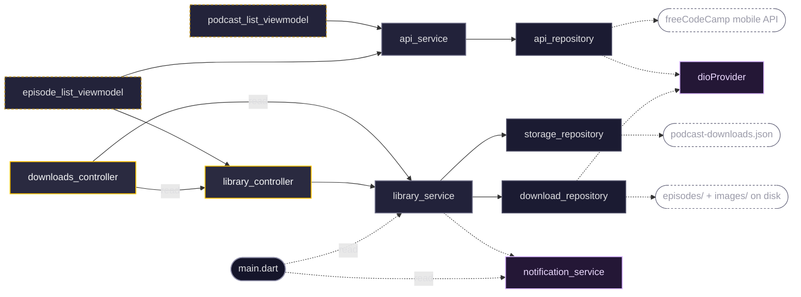
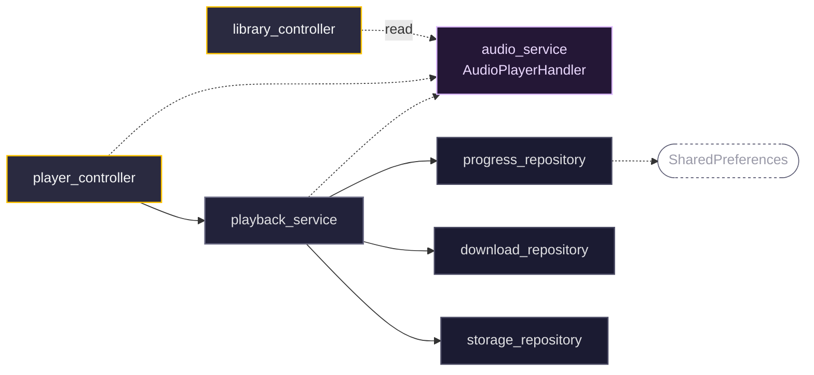
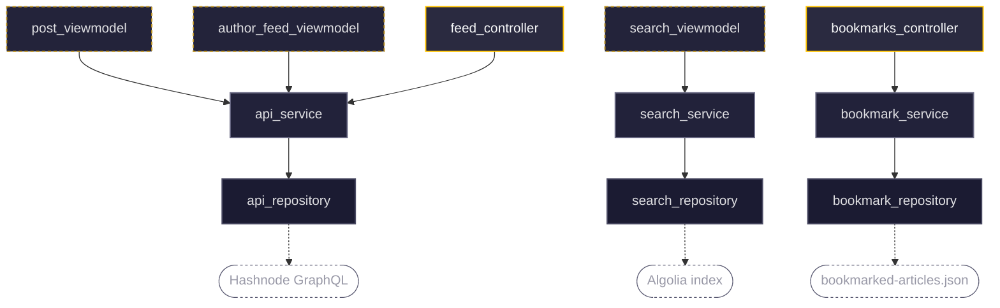
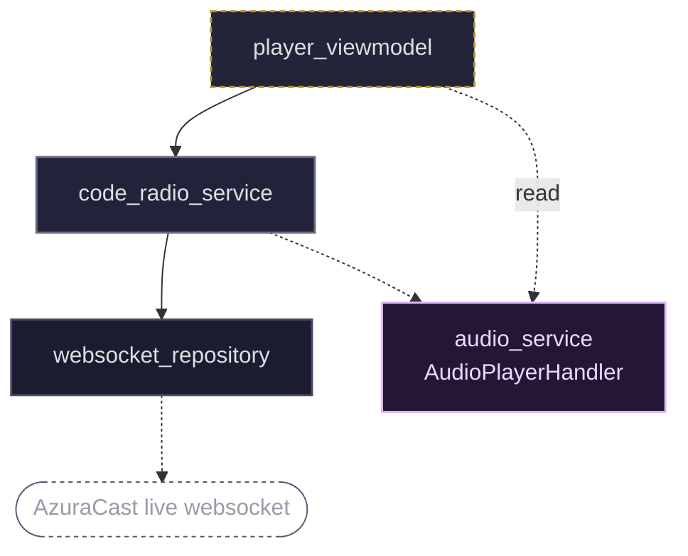
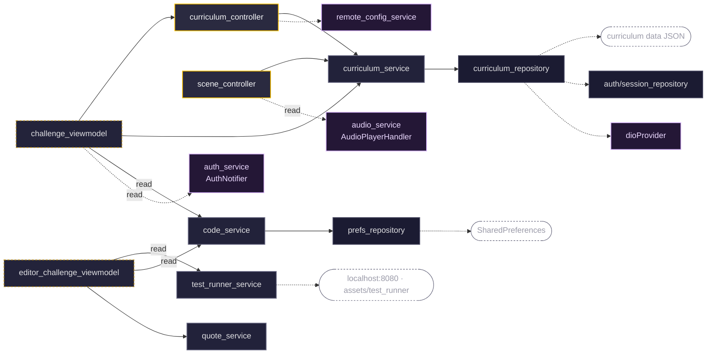
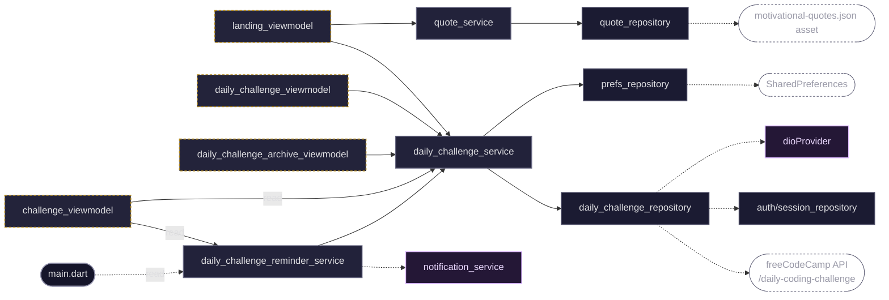
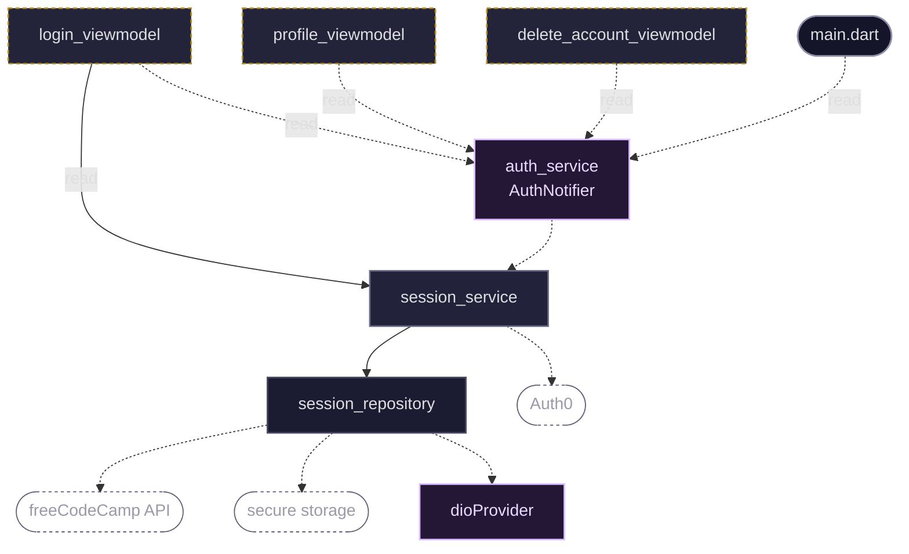

# Layer Map

Every provider dependency in the v8 app (`mobile-app-new/lib/`): which controllers reach which services, which services own which repositories, and where each repository gets its data. Views are not drawn.

## Legend

`view → controller / view-model → service → repository → data source`

| Shape | Meaning |
|---|---|
| Gold border | **Controller**: state shared by 2+ screens, in `controllers/` |
| Dashed gold | **View-model**: state used by one screen, beside its view |
| Grey | **Service**: between controllers and repositories, owns business rules |
| Dark | **Repository**: raw data source only |
| Violet | **App-level service** in `lib/services/` |
| Dashed pill | **Data source** outside the app |
| Grey pill | `main.dart` |

Solid arrows go one step down the chain. Dashed arrows leave it, to an app-level service, a data source or `main.dart`. An arrow labelled `read` is a one-shot `ref.read`; every other arrow is reactive.

## Podcasts

### Catalogue, library and downloads



### Playback and resume



There are two graphs because the code is split the same way: audio on one side, podcast data on the other. `storage_repository` and `download_repository` appear in both because both services own them. `library_controller` appears in the second only because it stops playback before an episode is deleted.

**Screens:** `podcast_list_view`, `episode_list_view`, `episode_view`, `downloads_view`, plus the `episode_tile`, `download_button` and `podcast_grid_tile` widgets.

- **Two controllers, deliberately separate.** `library_controller` answers "is this on disk?". `downloads_controller` tracks transfers in progress. The library holds data that changes rarely and many widgets watch; downloads writes progress several times a second.
- **`downloads_controller` only reads.** It calls `library_controller.refresh()` after a download, because only the notifier can push new state to what the grid and tiles watch. `refresh()` assigns `AsyncData` directly, where `ref.invalidate` would flash a spinner.
- **"Is this downloaded?" is answered by `playback_service.playbackUris()`** from the store row, not from the controller's cached state or the filesystem.
- **`playback_service` runs off-screen and owns resume progress.** It holds raw stream subscriptions, so positions keep saving when no podcast screen is mounted.
- **Only `storage_repository` is `keepAlive`**, so every write to `podcast-downloads.json` goes through one serialised queue, even after the rest of the chain has been disposed and rebuilt. `player_controller` holds a `KeepAliveLink` while the handler holds an episode, which also covers a pause (exactly as long as the media notification exists). `downloads_controller` holds one while a transfer is running. Everything below them stays alive through them. A failed download is not kept, so leaving the screen resets its retry icon.
- **Both API repositories share one `Dio`** through `dioProvider`.

## News



**Screens:** `feed_view`, `tag_feed_view`, `author_feed_view`, `post_view`, `search_view`, `bookmark_feed_view`, `bookmark_post_view`, `image_view`, plus the `post_feed_list` and `bookmark_button` widgets.

- **The reference implementation.** It has three independent stacks; each service owns exactly one repository and nothing crosses between them.
- **`feed_controller` is a family** keyed by the sealed `NewsFeedSource` (all / tag / author), so the main, tag and author feeds share one implementation.
- **No app-level services.** The API repository builds its own `GraphQLClient` rather than using `dioProvider`.

## Code Radio



**Screen:** `player_view`.

- **The service drives the notification.** It holds a raw websocket subscription inside a keepAlive provider and pushes song changes to the audio handler, so the notification keeps updating off-screen.
- **No `controllers/` folder.** There is one screen, so the state is a view-model beside it.

## Learn

### Curriculum, challenges and the editor



### Daily challenge, reminders and the landing page



The curriculum side and the daily-challenge side share no service. `challenge_viewmodel` appears in both because a daily challenge is solved on the ordinary challenge screen, which then records it through the daily services.

**Screens:** `landing_view`, `superblock_view`, `module_view`, `challenge_view` (with its `english_view`, `lesson_view`, `quiz_view` and `python_project_view` bodies), `editor_challenge_view`, `daily_challenge_view`, `daily_challenge_archive_view`, `scene_fullscreen_view`, plus the `block_card`, `daily_challenge_card`, `complete_button`, `quiz_audio_player` and `scene/` widgets.

- **`curriculum_controller` is the shared one.** The landing, superblock and module screens all watch it, and `challenge_viewmodel` watches its `superBlockProvider`.
- **Both API repositories use auth's `session_repository`**, which supplies `apiUrl` and wraps signed-in requests. Any 401 signs the user out everywhere.
- **The only service-to-service edge in any feature:** `daily_challenge_reminder_service` asks `daily_challenge_service` for today's challenge, then checks the user's completed list before rescheduling. `main.dart` calls it at startup.
- **`test_runner_service` is the only `keepAlive` in Learn.** It owns an `InAppLocalhostServer` on port 8080 plus headless web views (Babel and the test evaluator), so the next challenge never fights the previous one for the port.
- **Some views skip their view-model:** `editor_challenge_view` reads `code_service` and the test-runner server, `daily_challenge_view` watches `daily_challenge_service`, and `quiz_audio_player` and `scene_controls` use the audio handler.

## Auth & Settings



**Screens:** `login_view`, `profile_view`, `settings_view`, `delete_account_view` and the app drawer. All of them also watch `authProvider` directly for the current user.

- **`AuthNotifier` is the only place auth state changes.** View-models read the notifier and call its methods; only login goes below it, to start a sign-in flow.
- **The session layer is `keepAlive`** and lives for the app's lifetime. Learn's two API repositories depend on it too.

## Regenerating

The edges come from resolving every `ref.watch` / `ref.read` / `ref.listen` in `lib/` back to the file that declares the provider (map each `final xProvider` in `*.g.dart` to its source file). From `mobile-app-new/`:

```sh
for f in $(find lib -name '*.dart' ! -name '*.g.dart' ! -name '*.freezed.dart' | sort); do
  tr '\n' ' ' < "$f" | grep -oE 'ref *\. *(watch|read|listen) *\( *[A-Za-z_][A-Za-z0-9_]*' \
    | sed -E 's/ref *\. *//; s/ *\( */ /' | sort -u | while read m p; do echo "${f#lib/}|$p|$m"; done
done
```

Seven edges are invisible to this method because the provider sits behind a local name, so they are added by hand:
- `_provider` getters in `post_feed_list`, `episode_list_view` and `editor_challenge_view`
- `_runner` in `editor_challenge_viewmodel`
- a local `provider` variable in `challenge_view`, `complete_button` and `module_view`

A pair that appears as both `read` and `watch` counts as a watch. Diff the output against the nodes already drawn: a wrong edge survives regeneration if nobody checks it.
